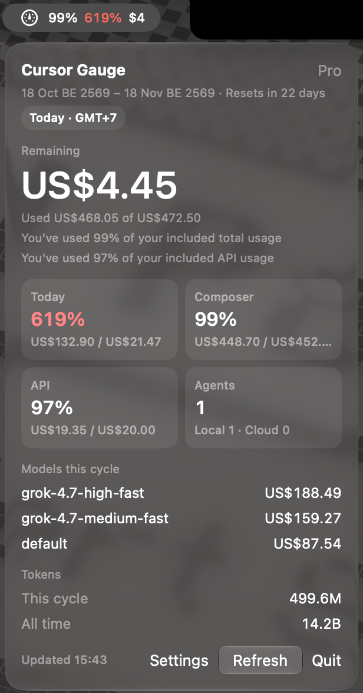

# Cursor Gauge

A lightweight macOS menu bar app that shows your Cursor plan usage and how much you have left this billing cycle.

No browser tab, no manual cookie paste — Cursor Gauge reads your session from the local Cursor IDE database and fetches usage from Cursor's dashboard API.



Cursor Gauge is a fork of [CursorBar](https://github.com/c-johannesen/cursorbar) by [c-johannesen](https://github.com/c-johannesen).

## Features

- **Menu bar icon** — a system gauge symbol plus the figures you turn on in Settings. A yellow badge means an agent needs input. With every switch off, only the gauge remains
- **Configurable menu bar** — Settings chooses gauge, quota percent, agent badge, today percent, remaining money, and overspend. The dropdown still shows the full panel
- **Languages** — System, Thai, or English. Dates and currency follow the Mac
- **Daily utilization** — today's spend, from local midnight, measured against a daily budget (total quota / working days in the billing cycle). Near the daily budget turns yellow; over 100% turns red
- **Pool breakdown** — shows the included balance, the Composer / Cursor Models pool (`$200` Pro `1x` / `$600` Pro+ `3x` / `$4,000` Ultra `20x` floor, scaled dynamically from actual usage and percent), and the API / Other Models pool (`plan.limit`, or `$20` Pro / `$70` Pro+ / `$400` Ultra)
- **Models & tokens** — top models by spend this cycle, plus cycle and all-time token totals from your public Cursor profile
- **Overspend tracking** — shows charges beyond the included pool and on-demand spend with budget/remaining
- **Billing cycle info** — current period dates and days until reset
- **Auto-refresh** — on launch and every 5 minutes, with a manual Refresh button anytime
- **Built-in updates** — checks GitHub Releases on startup, with a manual check button and one-click update from Settings

## Requirements

- macOS 26 or later
- [Cursor IDE](https://cursor.com) installed and signed in on this Mac
- Swift 6 — only needed if [building from source](#build-from-source)

## Install

### Homebrew

```bash
brew tap charcoaldev04/cursor-gauge
brew trust charcoaldev04/cursor-gauge
brew install --cask cursor-gauge
```

This installs `Cursor Gauge.app`. The tap is [homebrew-cursor-gauge](https://github.com/CharcoalDev04/homebrew-cursor-gauge). Homebrew 7 will not install a third-party cask until the tap is trusted.

### Download

Download the latest `CursorGauge-*.zip` from [Releases](https://github.com/CharcoalDev04/cursor-gauge/releases), unzip it, and move `Cursor Gauge.app` to `/Applications`. Then open it:

```bash
open -a "Cursor Gauge"
```

### Build from source

```bash
git clone https://github.com/CharcoalDev04/cursor-gauge.git
cd cursor-gauge
bash scripts/install.sh
```

This builds Cursor Gauge locally, installs it to `/Applications/Cursor Gauge.app`, and opens it.

### Launch later

```bash
open -a "Cursor Gauge"
```

Or, if you built from source:

```bash
bash scripts/launch.sh
```

## Usage

| Menu bar | Click to open dropdown |
|----------|------------------------|
| Gauge and the figures you enabled | Click to open the panel |

**Menu bar**

- Yellow badge — that many agents need your input
- Yellow today percent — today's spend is at 90–100% of the daily budget
- Red quota or today percent — quota is at or over 100% (or there is overspend), or today's spend is over 100%
- Dim gauge — nothing is running and quota is 0%

Agent status is read from local Cursor IDE data (transcripts and `state.vscdb`). Cloud agent status and plan/input flags can lag the UI by a minute or two because the IDE debounces writes to disk. Click an agent under **Needs input** to focus it in the Cursor app.

**Color in the panel**

- Yellow value — today's spend is at 90–100% of the daily budget
- Red value — a pool is at 100% or today's spend is over 100%

**Auto-refresh:** immediately on launch, then every **5 minutes** while the app is running.

**Errors:** if something goes wrong, the menu bar shows `!` — open the dropdown for details.

## Troubleshooting

Check that Cursor Gauge can read your account:

```bash
"/Applications/Cursor Gauge.app/Contents/MacOS/CursorGauge" --status
```

Expected output: `OK 42%` (your percentage will differ).

Common issues:

| Problem | Fix |
|---------|-----|
| `!` in menu bar | Make sure Cursor is installed and you're signed in, then click **Refresh** |
| App won't open from Finder | Run `bash scripts/launch.sh` or `xattr -cr "/Applications/Cursor Gauge.app"` — clears Gatekeeper quarantine flags |
| `Swift is not installed` | Run `xcode-select --install` |
| `No auth token found` | Sign out and back into Cursor, then relaunch Cursor Gauge |
| `Could not parse auth token` | Update Cursor Gauge. Current Cursor seals the login token; signing in again does not turn it back into a JWT. If macOS asks, allow Keychain access to **Cursor Safe Storage** |

## How it works

1. Reads `cursorAuth/accessToken` from Cursor's local SQLite database  
   `~/Library/Application Support/Cursor/User/globalStorage/state.vscdb`
2. If Cursor sealed the token (`cursor-safe-storage:v1:`), decrypts it with the **Cursor Safe Storage** keychain item, then derives a session cookie from the JWT
3. Calls `GET https://cursor.com/api/usage-summary`, `POST https://cursor.com/api/dashboard/get-filtered-usage-events`, and your public Cursor profile for token totals

The token is read fresh on every refresh and is **never stored** by Cursor Gauge.

## Development

```bash
git clone https://github.com/CharcoalDev04/cursor-gauge.git
cd cursor-gauge

# Build only
bash scripts/package.sh

# Build, install to /Applications, and launch
bash scripts/package.sh --install --open

# Run self-checks
.build/release/CursorGauge --self-check

# Verify API access
.build/release/CursorGauge --status
```

Project layout:

```
Sources/CursorGauge/
  App.swift                   # MenuBarExtra entry point & CLI flags
  PanelView.swift             # Dropdown panel & Settings view
  MenuBarStatus.swift         # Menu bar gauge, figures, and badge
  MenuBarChrome.swift         # Menu bar luminance sampling
  MenuBarChromeMonitor.swift  # Dark/light menu bar observer
  L10n.swift                  # English & Thai strings
  AgentMonitor.swift          # Live agent count & needs-input detection
  TokenProvider.swift         # Read & decrypt auth from Cursor IDE DB
  CursorAPI.swift             # Fetch usage summary, events, and profile tokens
  UsageSummary+Resolved.swift # Pool limits & credit floors
  UsageMath.swift             # Daily pace, model ranking, and self-checks
  UsageStore.swift            # Refresh timer & display state
  UpdateChecker.swift         # GitHub release updates
scripts/
  install.sh                  # One-step build & install
  launch.sh                   # Start the app
  package.sh                  # Build .app bundle
  release.sh                  # Package release zip & tag
```

## Limitations

- Uses Cursor's **undocumented** dashboard API — may break without notice
- Agent status is inferred from local IDE files — may lag the UI or miss edge cases
- Individual Cursor accounts only (reads your local IDE session)
- Not signed with an Apple Developer ID — first launch may require right-click → Open, `xattr -cr`, or `scripts/launch.sh`

## Contributing

Pull requests are welcome — see [CONTRIBUTING.md](CONTRIBUTING.md).

The `main` branch is protected: only the repository owner can push to or merge into `main`. Everyone else should fork the repo and open a PR.

## License

MIT — see [LICENSE](LICENSE).

Original work copyright (c) 2026 [c-johannesen](https://github.com/c-johannesen). This fork keeps that copyright notice.
